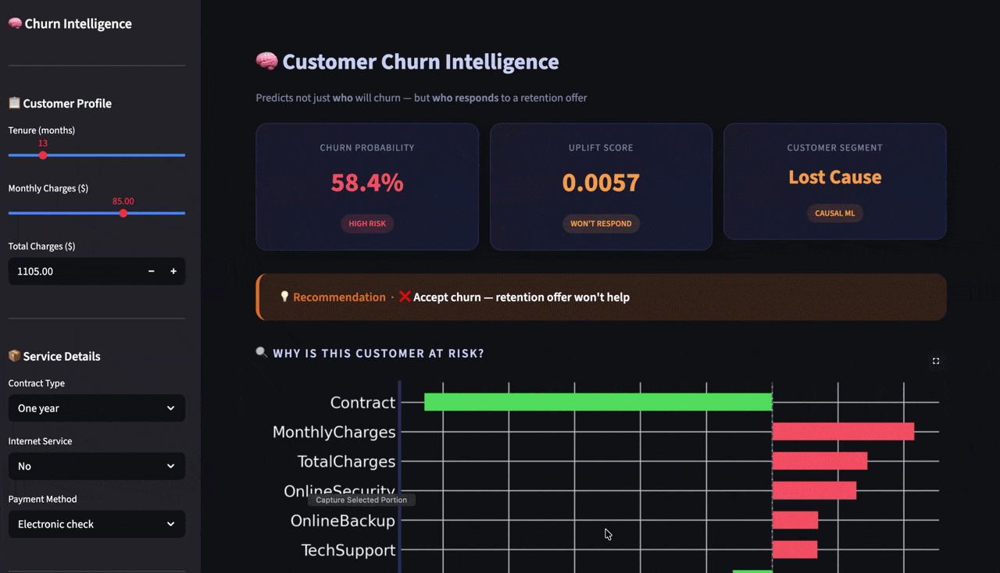

# Customer Churn MLOps

This project builds a customer churn prediction system that goes beyond simple risk scoring. It combines predictive modeling, explainability, and uplift modeling to identify customers who are likely to churn and most likely to respond to a retention offer.



## Overview

The repository uses the Telco Customer Churn dataset to:

- predict whether a customer is likely to churn
- explain which features drive the prediction
- estimate treatment uplift for retention offers
- segment customers into actionable groups
- expose the model through an API and notebook-based workflow

The core idea is practical: not every customer with a high churn risk should receive an offer. Uplift modeling helps target only the customers who are both at risk and likely to respond.

## Project flow

1. Data cleaning and exploratory analysis
2. Feature engineering and churn prediction
3. SHAP-based explainability
4. Uplift modeling for causal targeting
5. Customer segmentation for retention strategy
6. API and dashboard experimentation

## Notebook structure

- `1.eda.ipynb` — dataset exploration, cleaning, preprocessing, and churn model training
- `2_uplift.ipynb` — synthetic treatment setup, uplift learning, and customer segmentation
- `3_API.ipynb` — FastAPI model serving and prediction endpoint testing
- `4_streamlit.ipynb` — dashboard prototype for interactive prediction and explainability
- `WA_Fn-UseC_-Telco-Customer-Churn.csv` — source dataset

## Dataset

The project uses the Telco Customer Churn dataset, which contains customer subscription and billing attributes such as:

- tenure
- contract type
- monthly charges
- total charges
- internet service type
- payment method
- churn label

## Modeling approach

### Churn prediction

The churn model uses an XGBoost classifier with class imbalance handling via SMOTE. This helps improve recall for the minority churn class.

### Explainability

SHAP is used to interpret model decisions and identify the top contributors to churn risk for each customer.

### Uplift / causal modeling

A T-learner style causal uplift setup is used to estimate an offer effect. Customers are segmented into groups such as:

- Persuadable
- Sure Thing
- Lost Cause
- Sleeping Dog

This allows the business to prioritize retention actions where they are most effective.

## Business value

Instead of giving discounts to all at-risk customers, this approach focuses on customers who are most likely to respond to a retention offer. That leads to lower campaign cost and better retention efficiency.

Example outcomes reported in the project workflow:

- AUC-ROC around 0.8186
- Meaningful uplift segmentation
- Retention budget savings through targeted interventions

## Tech stack

- Python
- pandas, NumPy
- matplotlib, seaborn
- scikit-learn
- imbalanced-learn (SMOTE)
- XGBoost
- SHAP
- causalml
- MLflow
- FastAPI
- Streamlit

## Run locally

The local Streamlit app reads the included CSV, trains the XGBoost churn model
on first launch, and caches it while the app is running. No pre-trained model
files or Colab upload steps are required.

```bash
python3 -m venv .venv
source .venv/bin/activate
python -m pip install -r requirements.txt
streamlit run app.py
```

Open [http://localhost:8501](http://localhost:8501) in your browser. The app
shows holdout ROC-AUC, lets you enter customer details, and returns a churn
probability with a ranked feature-importance view.

The notebooks remain available for the full exploratory, API, and dashboard
experiments. The local app does not present uplift estimates as actionable:
the uplift notebook generates treatment assignment synthetically, so those
estimates are not validated by real retention-offer outcomes.

## Repository structure

```text
customer-churn-mlops/
├── app.py
├── .gitignore
├── requirements.txt
├── 1.eda.ipynb
├── 2_uplift.ipynb
├── 3_API.ipynb
├── 4_streamlit.ipynb
├── README.md
├── customer_churn.gif
├── WA_Fn-UseC_-Telco-Customer-Churn.csv
└── .kilo/
```

## Notes

- This project is focused on experimentation and demonstration.
- Model artifacts such as pickled models are generated during notebook execution.
- The project is a strong example of applied MLOps thinking: predictive modeling + explainability + operationalization + business impact.

## License

This project is intended for educational and portfolio use. Add an appropriate license if you plan to share it publicly.
